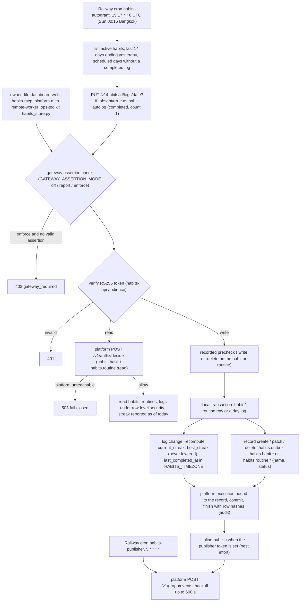

# 01 — Business process (As-Is / To-Be)

life-habits-api คือ cell ที่เก็บ habit และ routine ของ owner พร้อม log รายวัน และเป็นผู้คำนวณ streak เองทุกครั้งที่ log เปลี่ยน ผู้เรียกคือ owner ผ่าน `life-dashboard-web`, `habits-mcp`, hosted tool hub, ops-toolkit `habits_store.py` และ cron auto-grant รายสัปดาห์ของ repo นี้; สิทธิ์ execution/audit และ graph ทำผ่าน `empire-platform`

Last reviewed: 2026-11-27 · commit `4ae2ec8`

## As-Is (จากโค้ดวันนี้)

Sources: `src/solo_habits/app.py` (`emit`, `publish_soon`, `streak`, `refresh_streak`, routes `/v1/habits*`, `/v1/routines*`, `/v1/habit-logs`, `/v1/routine-logs`), `src/solo_habits/autogrant.py`, `src/solo_habits/gateway.py`, `src/solo_habits/publisher.py`, `src/solo_habits/platform.py`, `.railway/railway.ts`, `README.md`

ข้อเท็จจริงสำคัญจากโค้ด:

- log รายวัน (`PUT/DELETE /v1/{habits,routines}/{id}/logs/{date}`) มี audit `habits.<kind>.logged|unlogged` แต่ไม่เขียน outbox: graph ได้เฉพาะ event ของ habit และ routine (`created|updated|deleted`)
- ผู้เรียกเขียน `current_streak`, `best_streak`, `last_completed_at` เองไม่ได้: service คำนวณใหม่ใน transaction เดียวกับ log
- auto-grant เรียก API ของ cell เอง (ไม่แตะ database) จึงผ่าน precheck, execution และ audit เหมือนผู้เรียกอื่น; `if_absent=true` ไม่ทับ log ที่ completed แล้ว
- `GATEWAY_ASSERTION_MODE` ค่าเริ่มต้น `off`; ค่าที่ใช้ใน production [ต้องยืนยัน]

## To-Be (จาก `PRODUCT.md` §Product Purpose และ §Measures)

- ทุกวันตามตารางของ habit ที่ active มี log (มือหรือ auto-grant) และ streak ทุก client เป็นค่าที่ service คำนวณ
- habit ที่ active มี log ของเมื่อวาน: เป้า ทุก habit ที่ถึงตาราง
- สัดส่วนวันที่ auto-grant กับลงมือ: เป้า [ต้องยืนยัน: owner target]
- แถว outbox ที่ยังไม่ publish หลัง 1 ชั่วโมง: เป้า 0
- 5xx และ p95 latency ของ `/v1/habits`
- out of scope: การเตือนให้ log habit [ต้องยืนยัน]

ไม่มี diagram To-Be ของกระบวนการใน repo (`specs/001-l2-baseline/spec.md` ไม่เปลี่ยนพฤติกรรม)

## Gap

| ID | As-Is → To-Be | Status | Owner | Evidence |
|---|---|---|---|---|
| G1 | วันที่ไม่ได้ log ถูกเติมโดย auto-grant สัปดาห์ละครั้ง (วันอาทิตย์) จึงอาจไม่มี log ของเมื่อวานได้ถึง 7 วัน → ทุก habit ที่ถึงตารางมี log ของเมื่อวาน | decide | owner | `PRODUCT.md` §Measures; `.railway/railway.ts` (`15 17 * * 6`); `src/solo_habits/autogrant.py` |
| G2 | ไม่มีตัววัดอายุแถว outbox ที่ค้าง; sweep รันชั่วโมงละครั้ง (`5 * * * *`) → 0 แถวค้างเกิน 1 ชั่วโมง | todo | claude | `PRODUCT.md` §Measures; `.railway/railway.ts`; `src/solo_habits/publisher.py` |
| G3 | ยังไม่มีเป้าของสัดส่วนวัน auto-grant กับลงมือ → owner กำหนด | decide | owner | `PRODUCT.md` §Measures [ต้องยืนยัน: owner target] |
| G4 | ไม่มี To-Be ของกระบวนการที่เขียนไว้ (diagram หรือ spec) → owner กำหนด | decide | owner | ไม่มีใน `PRODUCT.md` / `specs/` |

## Open questions

- `PRODUCT.md` §Operating Context บอกว่า `habits-publisher` รันทุก 15 นาที แต่ `.railway/railway.ts` และ `README.md` เป็น `5 * * * *` (ชั่วโมงละครั้ง): ควรแก้ `PRODUCT.md` หรือเปลี่ยน schedule
- `GATEWAY_ASSERTION_MODE` ใน production เป็น `report` หรือ `enforce` [ต้องยืนยัน]
- notifications cell ส่งการเตือนให้ log habit หรือไม่ (`PRODUCT.md` ระบุ [ต้องยืนยัน])
